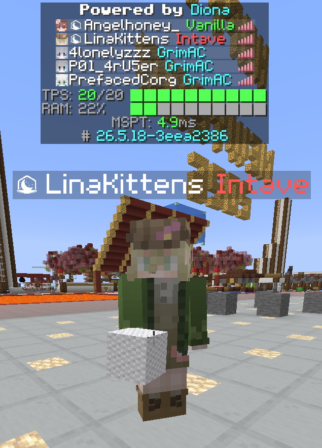

# Lumine

Lumine is a client-side Fabric mod for Minecraft that makes the server see you as a Lunar Client user. It implements Lunar's Apollo protocol and connects to Lunar's authentication and cosmetics services.

## Features

- Spoofs the client brand as `lunarclient:<version>`.
- Registers the Apollo and legacy Lunar networking channels used by Lunar Client.
- Sends a Lunar-compatible Apollo player handshake with the Minecraft version, Lunar version, Git commit, installed mods, checkout support, and mod status.
- Handles Apollo server events such as configurable settings, ping requests, transfer requests, and installed-mod requests.
- Authenticates with Lunar and maintains a reconnecting WebSocket connection for presence and cosmetics.
- Loads Lunar player logos and displays them in the tab list and player nametags.

See the [Apollo developer documentation](https://lunarclient.dev/apollo/developers/events) for the protocol and event details.

## Comparison

| 26.2 with Lumine | Lunar Client |
| --- | --- |
|  |  |

## Requirements

- Minecraft 26.2
- Fabric Loader 0.19.3 or newer
- Fabric API
- Java 25

## Build

On Windows:

```powershell
.\gradlew.bat build
```

On Linux or macOS:

```bash
./gradlew build
```

The built mod is written to `build/libs`.

## Development

Run the client with:

```bash
./gradlew runClient
```

Use `gradlew.bat` instead of `./gradlew` on Windows.

## License

Copyright (c) 2026 cats. All rights reserved.
